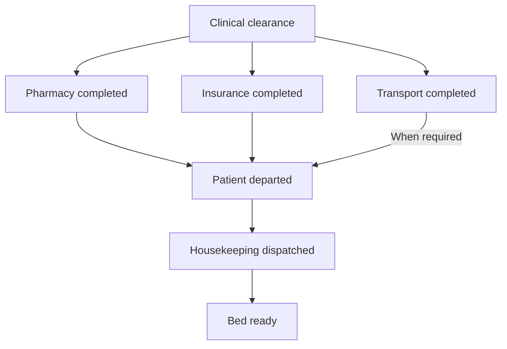

# ClearTurn · bAIn

**From clinical clearance to a bed ready for the next patient.**

ClearTurn is a local hospital discharge simulator built by team **bAIn** for the IEEE TechX 2026 AI Agent Arena, Domain 3 — Healthcare Operations & Clinical Workflow. It gives staff a shared view of what is ready, what is blocked, and who can take the next step. The React dashboard includes a patient workflow graph, a specialist inbox, an advisory assistant, and an audit timeline.

**[Explore a scenario](#explore-a-scenario) · [Run locally](#run-locally) · [Walk through case #402](#walk-through-case-402) · [Browse the code](#repository-guide)**

## What happens after clearance?

> Case #402 has clinical clearance, but Pharmacy is out of stock and Insurance has rejected authorization. Transport can prepare while both specialists work. Departure stays locked until the required milestones are complete, and Housekeeping can begin only after Transport records departure.



All applicable incoming dependencies must be complete before a milestone can advance. The FastAPI backend enforces that directed acyclic graph (DAG) and the role permitted to act at each step. Pharmacy and Insurance mock checks can run concurrently. SQLite serializes writes, checks the version for each change, and records the new state and audit event together. A stale request returns `409 STALE_VERSION`. The audit timeline shows the actor’s role, the outcome, and the case version.

The **AI Assistant** summarizes visible blockers, suggests staff actions, and drafts escalation text. By default it uses the labeled `deterministic_fallback` mode. An optional model receives a role-filtered summary and its response is validated before display. Workflow changes go through the FastAPI rules and authorized staff actions. Transport and Housekeeping receive operational views with clinical notes, patient names, and clearance timestamps redacted.

## Explore a scenario

Expand a scenario to see what ClearTurn does and inspect the sample data.

<details>
<summary><strong>Case #402 · Pharmacy and Insurance report blockers at the same time</strong></summary>

`MEDICATION_STOCKOUT` goes to the pharmacist, while `ERR_AUTH_409` goes to the billing specialist. Each specialist can work independently. A successful review moves its milestone from `blocked` to `ready`, and the department confirms completion separately. Transport can prepare during both reviews.

[Starting workflow](shared/sample_responses/patient_402_workflow.json) · [Specialist inbox sample](shared/sample_responses/exceptions.json) · [Advisory response sample](shared/sample_responses/agent_analysis.json)

</details>

<details>
<summary><strong>Case #404 · Billing upholds the insurance denial</strong></summary>

Billing’s review is recorded, Insurance stays `blocked`, and departure remains locked. To try it locally, select **Denial upheld** in the billing specialist’s **Exception Inbox**, then reopen the case workflow.

</details>

<details>
<summary><strong>Case #405 · Housekeeping tries to dispatch before departure</strong></summary>

The dashboard disables the dispatch action. The backend also rejects a premature request with `409 INVALID_TRANSITION` and records the attempt in the audit timeline. After Transport resolves the delay, it must complete preparation and record departure before Housekeeping can dispatch.

[Audit timeline sample](shared/sample_responses/patient_405_audit.json) · [Backend workflow tests](tests/backend/test_transport_workflow.py)

</details>

## Run locally

Install **Python 3.11+** and **Node.js 20+** with npm. Expand the instructions for your operating system and start each terminal from the repository root. The API seeds SQLite on first startup. With the default provider setting, the demo runs offline after dependencies are installed.

<details>
<summary><strong>Windows PowerShell</strong></summary>

**Terminal 1 — FastAPI**

```powershell
python -m venv .venv
.\.venv\Scripts\python.exe -m pip install -r requirements.txt
if (!(Test-Path .env)) { Copy-Item .env.example .env }
.\.venv\Scripts\python.exe -m uvicorn backend.main:app --env-file .env --host 127.0.0.1 --port 8000
```

**Terminal 2 — React dashboard**

```powershell
cd frontend/web
if (!(Test-Path .env.local)) { Copy-Item .env.example .env.local }
npm.cmd ci
npm.cmd run dev
```

</details>

<details>
<summary><strong>macOS or Linux</strong></summary>

**Terminal 1 — FastAPI**

```bash
python3 -m venv .venv
.venv/bin/python -m pip install -r requirements.txt
test -f .env || cp .env.example .env
.venv/bin/python -m uvicorn backend.main:app --env-file .env --host 127.0.0.1 --port 8000
```

**Terminal 2 — React dashboard**

```bash
cd frontend/web
test -f .env.local || cp .env.example .env.local
npm ci
npm run dev
```

</details>

Open the [dashboard](http://127.0.0.1:5173/) and look for **API Online**. If Vite selects a different port, use the URL printed in your terminal. Vite proxies `/api` to FastAPI on port `8000`. You can check the [health endpoint](http://127.0.0.1:8000/api/health) or explore the [interactive API reference](http://127.0.0.1:8000/docs).

<details>
<summary><strong>Configure an optional model for the AI Assistant</strong></summary>

Set `BAIN_LLM_PROVIDER` and the corresponding settings in the backend `.env`, then restart FastAPI. The default in [`.env.example`](.env.example) is `disabled`.

| Provider setting | Configuration |
| --- | --- |
| `groq` | Set `GROQ_API_KEY`. Use `BAIN_GROQ_MODEL` to choose the model. |
| `gemini` | Set `GEMINI_API_KEY`. Use `BAIN_GEMINI_MODEL` to choose the model. |
| `ollama` | Start Ollama with a locally installed model and set `BAIN_OLLAMA_MODEL`. Set `BAIN_OLLAMA_BASE_URL` if the service uses a different address. |

The assistant labels model responses `llm` and uses `deterministic_fallback` when the provider is disabled, unavailable, or returns invalid output. Keep provider keys in the backend `.env` and use synthetic case data in all modes.

</details>

<details>
<summary><strong>Troubleshoot startup or reset the demo</strong></summary>

**API shows offline.** Check that FastAPI is running on port `8000`. Open the [health endpoint](http://127.0.0.1:8000/api/health) to confirm the backend is responding.

**The API reports missing or duplicate tokens.** Compare `.env` with `.env.example`. FastAPI requires seven distinct `BAIN_TOKEN_*` values. Each should match its `VITE_BAIN_TOKEN_*` counterpart in `frontend/web/.env.local`.

**Start with fresh demo cases.** Stop the API, then run `python scripts/reset_demo_db.py --force` from the repo root using the virtual environment. This replaces `bain-demo.sqlite3` in the system temporary directory by default. If the API uses a custom `BAIN_DB_PATH`, pass that path with `--database` when resetting.

</details>

## Walk through case #402

1. Open **#402** and inspect the workflow. Clinical clearance is complete. Pharmacy and Insurance are blocked, and the **Patient departed** and **Housekeeping dispatched** milestones are locked.
2. Switch to **Clinical Pharmacist**. In **Exception Inbox**, resolve `MEDICATION_STOCKOUT` with a synthetic note. Return to the workflow and complete **Pharmacy**. The exception review makes the milestone ready for this separate confirmation.
3. Switch to **Billing Specialist**. Review `ERR_AUTH_409`. For the turnover demo, record a simulated clearance and then complete **Insurance authorization**. Choosing **Denial upheld** keeps Insurance blocked and departure locked.
4. Switch to **Patient Transport**. Complete **Transport ready**, then record and complete **Patient departed** once the simulated patient has left.
5. Switch to **Environmental Services**. Complete **Housekeeping dispatched**, then **Bed ready** after simulated cleaning. Open **Audit Timeline** to see the role, outcome, and version for each action.

The dashboard advances a newly unlocked milestone through `in_progress` and then `completed`. Each submission needs a short reason. If the API reports `STALE_VERSION`, refresh the case and review its current state before retrying. The [demo runbook](docs/demo_plan.md) includes scenarios for early dispatch, parallel writes, and role-based redaction.

## Demo data

The API seeds six fictional cases. A fresh dashboard shows **5 active cases**, **4 blocked cases**, **5 open specialist reviews**, and **1 available bed**. These counts describe the seed data.

| Case | Starting scenario | What to try |
| --- | --- | --- |
| **#402** | Pharmacy stockout and insurance rejection | Work both specialist queues and follow the full path to bed ready |
| **#403** | Pharmacy stockout only | Resolve `MEDICATION_STOCKOUT` as the pharmacist |
| **#404** | Insurance rejection only | Choose **Denial upheld** and verify departure stays locked |
| **#405** | Transport delay | Resolve `TRANSPORT_DELAY` as Transport and verify the departure dependency |
| **#406** | No outstanding exceptions | Complete the standard handoff from Pharmacy to Housekeeping |
| **#407** | Turnover already complete | Inspect the seeded bed-ready state |

Use synthetic records throughout. The role selector uses local demo tokens, and Vite exposes `VITE_*` values to the browser. Keep real patient records and credentials out of the demo and its configuration. Pharmacy and Insurance are simulated, and all workflow actions are recorded locally.

## Repository guide

| Path | What it contains |
| --- | --- |
| [`frontend/web/`](frontend/web/) | React, TypeScript, and Vite dashboard |
| [`backend/main.py`](backend/main.py) | FastAPI routes, demo seed data, role checks, mock department reads, and SQLite workflow updates |
| [`backend/llm_advisory.py`](backend/llm_advisory.py) | Role-filtered advisory input, provider adapters, output validation, and deterministic fallback |
| [`shared/api_contract.yaml`](shared/api_contract.yaml) | Shared API contract and [sample payloads](shared/sample_responses/) |
| [`tests/backend/`](tests/backend/) | Workflow, privacy, exception, concurrency, and audit tests |
| [`scripts/reset_demo_db.py`](scripts/reset_demo_db.py) | Local synthetic database reset |

Run backend tests from the repo root with the virtual environment’s Python (`python -m pytest -q`). Run `npm run build` from `frontend/web/` to check the dashboard build. See the [architecture notes](docs/architecture.md) and [team workflow](docs/team_workflow.md) for implementation and contribution details.
